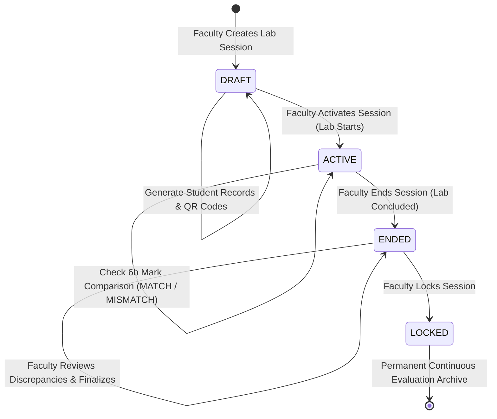
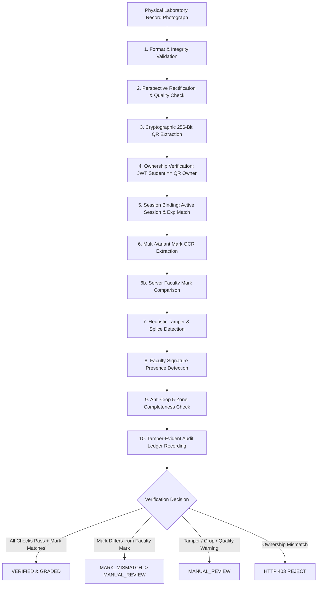

# System Architecture & Security Specification (Phases 1, 2, 3 & 4)

## Project
**AI-Powered Secure Laboratory Record & Mark Management System (`SecureLab`)**

---

## 1. Core Security Invariant & Zero-Trust Foundation

$$\text{JWT Authenticated Student} == \text{Database Record Owner} == \text{QR Token Owner} == \text{Assigned Active Session \& Experiment}$$

Under no circumstances does the backend trust client-supplied identity, experiment numbers, or marks:
1. **Zero Client Trust:** The server determines identity exclusively from cryptographically signed JWT tokens issued during login.
2. **AI Is Advisory, Never Authoritative:** The AI/computer-vision pipeline extracts and flags evidence; it **never** awards marks, overrides ownership, or changes database records without faculty authority.
3. **Server-Side Faculty Mark Authority (Phase 4):** The faculty member enters the authoritative continuous evaluation mark on the server. Student submissions never overwrite or modify this mark. Discrepancies between the physical document OCR and server mark trigger `MARK_MISMATCH` and route to `MANUAL_REVIEW`.
4. **Session Lifecycle Enforcement:** Lab sessions follow a strict finite-state machine (`DRAFT` $\to$ `ACTIVE` $\to$ `ENDED` $\to$ `LOCKED`). Submissions are only accepted while `status == ACTIVE`.
5. **Immutable Audit Trail:** All security events, ownership rejections, AI analyses, quality scores, tamper flags, and mark corrections are permanently stored in append-only audit ledgers.

---

## 2. Laboratory Session State Machine (Phase 4)



### State Definitions & Capabilities
| State | Submissions Allowed? | Record Generation? | Mark Editing? | Description |
| :--- | :--- | :--- | :--- | :--- |
| **`DRAFT`** | ❌ Blocked (422) | ✅ Allowed | ✅ Pre-Award Allowed | Session scheduled; sheets printed and distributed. |
| **`ACTIVE`** | ✅ Accepted | ✅ Allowed | ✅ Allowed | Live lab in progress; students submit physical records. |
| **`ENDED`** | ❌ Blocked (422) | ❌ Blocked | ✅ Final Grading | Conduction completed; submissions closed. |
| **`LOCKED`** | ❌ Blocked (422) | ❌ Blocked | ❌ Immutable | Official mark sheets locked; Excel export generated. |

---

## 3. Threat Model & Countermeasures

| Threat Scenario | Attack Vector | Security Countermeasure | System Action & Outcome |
| :--- | :--- | :--- | :--- |
| **Case 1: Ownership Hijacking** | Kavin logs in and uploads Arun's physical record sheet (Reg No 052) | Backend extracts QR token and matches against database record owner; cross-references OCR register number | **Hard Reject:** HTTP 403 `RECORD_OWNERSHIP_MISMATCH`. Security event logged to audit trail. |
| **Case 2: Mark Tampering / Alteration** | Student alters handwritten mark (e.g. 8.5 to 10.0) | Check 6b compares physical OCR mark against server-authoritative `facultyAwardedMark` | **Flagged:** `markVerificationStatus: 'MARK_MISMATCH'`, routed to `MANUAL_REVIEW`. Server mark preserved. |
| **Case 3: Incomplete Page Cropping** | Student crops the page to remove student identity or evaluation header | `DocumentLayoutAnalyzer` inspects aspect ratio and structural zones (`STUDENT_INFO`, `HEADER`, `FACULTY_EVAL`) | **Flagged / Retake:** Status `MANUAL_REVIEW` or `RETAKE_REQUIRED` with warning *"Critical document sections missing"*. |
| **Case 4: Digital Screenshots vs Physical Record** | Student uploads a computer screenshot rather than a physical camera capture | `ImageQualityAnalyzer` checks channel variance and synthetic optical characteristics; UI defaults to Camera Capture | **Flagged / Informational:** Non-camera capture flagged for faculty review. |
| **Case 5: Stale / Cross-Session Submission** | Student submits old photo from a previous semester or different session | Multi-Factor Session Binding checks: Record Session == Valid Session AND Selected Exp == Target Exp | **Rejected:** Mismatched session or expired token returns HTTP 422 or flags `MANUAL_REVIEW`. |
| **Case 6: Submission to Inactive Session** | Uploading when lab session is in `DRAFT`, `ENDED`, or `LOCKED` state | Server checks `session.status == 'ACTIVE'` before accepting physical submission | **Rejected:** HTTP 422 with message *"Session is not currently active for submissions"*. |
| **Case 7: Blurry / Damaged Photograph** | Student submits severely blurred photo where marks or text cannot be verified | `ImageQualityAnalyzer` computes normalized Laplacian variance; flags blur score $< 35.0$ | **Retake:** Status `MANUAL_REVIEW` / `RETAKE_REQUIRED` with prompt *"Severe blur detected — retake photo"*. |

---

## 4. 10-Factor Security & Verification Pipeline



### Verification Rules Summary
```
IF (qrRecord.studentId != authenticatedStudent.id) -> REJECT 403 (RECORD_OWNERSHIP_MISMATCH)
IF (targetRecord.isLocked == true) -> REJECT 422 (RECORD_LOCKED)
IF (session.status != "ACTIVE") -> REJECT 422 (SESSION_NOT_ACTIVE)
IF (qrRecord.id != targetRecord.id) -> REJECT 422 (WRONG_RECORD)
IF (qrRecord.labSessionId != targetRecord.labSessionId) -> REJECT 422 (WRONG_SESSION)
IF (tamper.status == "SUSPICIOUS") -> MANUAL_REVIEW
IF (quality.decision == "RETAKE_REQUIRED") -> MANUAL_REVIEW
IF (ocr.regNo != student.regNo) -> MANUAL_REVIEW
IF (ocr.expNo != target.expNo) -> MANUAL_REVIEW
IF (facultyAwardedMark != null && ocr.mark != facultyAwardedMark) -> MARK_MISMATCH (MANUAL_REVIEW)
IF (all_pass) -> VERIFIED (or PENDING if awaiting initial grading)
```

---

## 5. Continuous Evaluation Rubric & Excel Marksheet Export

### Continuous Evaluation Rubric (EEE Department)
The official laboratory evaluation rubric complies with university continuous assessment standards:
1. **Pre-Lab & Circuit Design (3.0 Marks):** Theoretical understanding, connection diagram, and safety checks.
2. **Conduction & Observations (4.0 Marks):** Machine wiring, meter readings, and tabular data collection.
3. **Calculations & Graphs (2.0 Marks):** Efficiency computation, equivalent circuit parameters, and characteristics plot.
4. **Viva Voce (1.0 Mark):** Oral examination on machine principles and fault analysis.
*Total Continuous Mark: 10.0 Marks.*

### Excel Marksheet Export Schema (`exceljs`)
Exported via `GET /api/faculty/sessions/:id/export-excel` as `EEE_Lab_Marks_<SessionCode>_<Date>.xlsx`:
- **Header Metadata:** Institution title, Department of Electrical & Electronics Engineering, Course Title, Session Code, Date.
- **Table Columns:** `S.No`, `Register No`, `Student Name`, `Class & Section`, `Experiment No`, `Unique Record Code`, `Faculty Awarded Mark`, `OCR Detected Mark`, `Mark Verification Status`, `Submission Time`, `Evaluation Status`.
- **Styling:** Midnight blue table header, alternating zebra row striping, centered register numbers, and color-coded status badges (green for `MATCH`, red for `MARK_MISMATCH`, amber for `MANUAL_REVIEW`).

---

## 6. Automated Test Suite (53/53 Tests Passing)

1. `demo_scenario.test.ts` (1 test): Complete 10-step student & faculty demonstration workflow.
2. `security.test.ts` (13 tests): Phase 1 zero-trust access control, JWT authentication, and QR invariant checks.
3. `phase2_ai_security.test.ts` (10 tests): Multi-factor OCR consistency, register number checks, and ownership rejection.
4. `phase3_authenticity.test.ts` (11 tests): Document authenticity, blurry photo rejection, crop detection, mark tampering, and faculty correction audit trails.
5. `phase4_workflow.test.ts` (18 tests): EEE session lifecycle, bulk record generation, duplicate prevention, cross-session rejection, OCR vs faculty mark match/mismatch, authoritative mark immutability, and Excel/ZIP exports.
